# Аутоматски трошкови возила — Упутство за употребу

> **Измени извор (Маркдовн).** Прегледачи и читач у апликацији отварају **рендеровани ХТМЛ**:
> - Веб: [`docs/user-manual/index.html`](index.html) (регенеришите са `./scripts/render-user-manual.sh`)
> - Апликација: Помоћ / О нама → комплетан приручник (у пакету ХТМЛ + снимци екрана)
>
> Не усмеравајте крајње кориснике на необрађене `.md` УРЛ адресе — прегледачи приказују само обичан текст.

Праћење прве камере за пуњење горива и трошкове возила, са опционом синхронизацијом на више уређаја и резервном копијом под **вашим** налозима у облаку.

Ово је **пун приручник** (снимци екрана + сваки корак). На телефону, **Мени → Помоћ** је краћи водич за почетак.

**Овде није покривено:** Увезите старе слике, експеримент поравнања и експеримент са пумпом (развојни / напредни алати).

---

## Садржај

1. [Шта вам треба](#what-you-need)
2. [Иконе на први поглед](#icons-at-a-glance)
3. [Отвори мени](#open-the-menu)
4. [Прво подешавање: Управљање возилима](#first-time-setup-manage-vehicles)
5. [Резервне копије и синхронизација са више уређаја](#backups-and-multi-device-sync)
6. [Напуните (гориво)](#fill-up-fuel)
7. [Почните путовање](#start-trip)
8. [Трошкови](#expenses)
9. [Извештаји](#reports)
10. [Подешавања (локалне поставке)](#settings-local-preferences)
11. [Синхронизација](#syncing)
12. [Помоћ и информације](#help--about)
13. [Сродни документи](#related-docs)

---

## Оно што вам треба

- Андроид телефон или таблет.
– За најбољи ОЦР: јасан приказ вашег **бројача километара на контролној табли** и **укупних вредности пумпе** (или унесите бројеве ручно).
– Опционо: налози **које контролишете** за податке у табели и/или резервну копију фотографија (погледајте [Резервне копије и синхронизација на више уређаја](#backups-and-multi-device-sync)).

---

##  Иконе на први поглед

Они се појављују на главним екранима. Познавање њих штеди много лова.

| Где | Икона / контрола | Шта ради |
|-------|----------------|--------------|
| Горња трака | **☰ Мени** (хамбургер) | Отвара фиоку за навигацију |
| Горња трака | **ⓘ** (помоћ странице) | Кратка помоћ за **тренутну** страницу (поред менија када је доступан) |
| Горња трака | **`?N`** (жуто) | Питања за преглед увоза на чекању — отвара Преглед увоза |
| Горња трака | **!** (црвено) | Табела или одредиште за фотографије недавно није успело — отворите **Синхронизовање** да бисте поправили |
| Горња трака | **☰ + ←** | Извештај деце и листа трошкова приказују **мени и назад** заједно; Центар за извештаје је само мени |
| Подешавања / уређивање горива | **←** | Назад (табела подешавања/фотографија и уређивање горива остају фокусирани назад) |
| Филл | **Бели круг** (затварач) | Снимање километраже или дисплеја пумпе за ОЦР |
| Филл | **Диск / Сачувај** | Сачувајте допуну (потребно је возило и најмање једно одо / запремина / цена) |
| Филл | **↕ стрелице** (прекидач режима) | Пребаците **режим бројача километара** са **режимом пумпе (цена/запремина)**. Зелена ивица истиче активну групу поља |
| Филл | **↔ стрелице** (између цене и обима) | Замените цену и обим ако их је ОЦР ставио у погрешна поља |
| Филл | **Зумирање 1к / …** | Односи зума камере када их објектив подржава |
| Попуни (након снимања) | **Освежи** на главном дугмету | Одбаците преглед и вратите се на камеру уживо |
| Попунити (приликом обраде) | **Кс** на главном дугмету | Откажи снимање у току/ОЦР |
| Екпенсе | **Сачувај** | Уштедите трошкове |
| Екпенсе | **Круг затварача** | Снимите фотографију рачуна |
| Екпенсе | **Галерија** | Изаберите слику признанице из библиотеке |
| Екпенсе | **Ретаке** | Обришите тренутну фотографију рачуна и снимите поново |
| Трошкови / Управљање возилима | **+ / −** ФАБс | Зумирајте преглед фотографије |
| Дијалог знаменитости | **Измени ОЦР** | Исправите или додајте оријентирни текст који су мотори пропустили |
| Табела / Обрасци за фотографије | **🔍 Претрага** | Претражите Гоогле диск за лист или фасциклу (након пријављивања) |

Симболи валуте у пољима трошкова и **Г/Л** у пољима запремине се могу додирнути: отворите мали мени да промените валуту или галоне у односу на литре за тај унос.

---

## Отворите мени

1. Додирните **☰** у горњем левом углу.
2. Изаберите страницу.

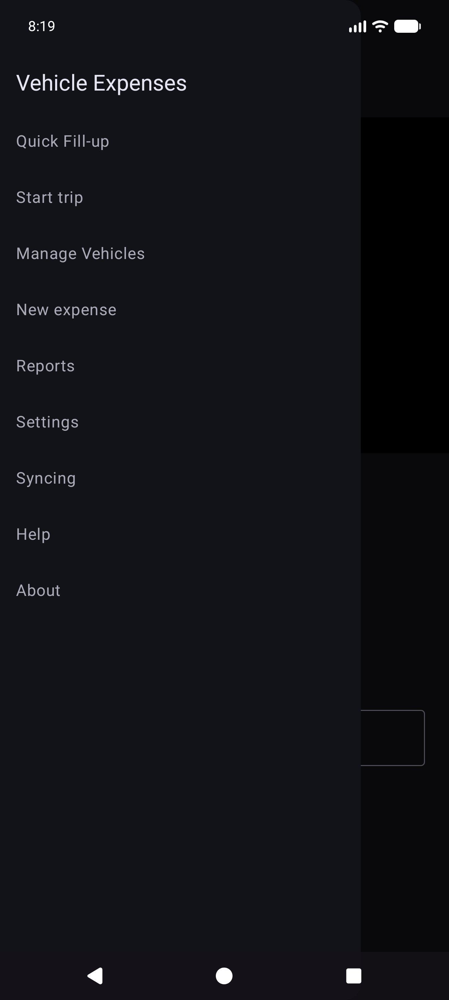

**Главна фиока:** Попуните · Почните путовање · Управљајте возилима · Нови трошкови · **Извештаји** · Подешавања · Синхронизација · Помоћ · О.

**Фиока за експерименте** (Подешавања → Прикажи екране експеримента): Експеримент поравнања · Експеримент са пумпом · **Увези старе слике**.

**Преко чворишта извештаја (не главне фиоке):** Листа трошкова · Попуните историју.

---

## Прво подешавање: Управљање возилима

ОЦР и **аутоматско упаривање возила** најбоље функционишу након што региструјете свако возило са **референтном фотографијом на контролној табли**, покренете **Дисцовери**, подесите усев километраже из семена весла и сачувате оријентире за ту цртицу.

### Отворите управљање возилима

Мени → **Управљање возилима**. Изаберите возило (или **Додај ново возило**).

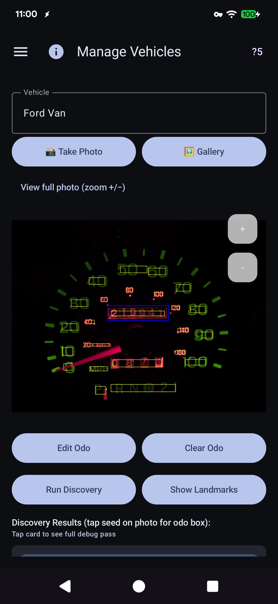

### Додајте или уредите возило

1. Отворите падајући мени **Возило** → изаберите возило или **Додај ново возило**.
2. Снимите или изаберите јасну **референтну слику на цртици** (пуна инструмент табла, добро осветљена, телефон отприлике квадратно постављен). Користите **Снимите фотографију** или **Галерија**.
3. Додирните **Рун Дисцовери** — откривање весла поставља жуте **семе** на фотографију (оријентири користе исти `"ML Kit"` ЈСОН као и раније).
4. Додирните **Изабери Одо**, тапните семе на цифре, подесите ручке, а затим **Сачувај**.
5. **Едит Одо** подешава оквир који је већ тамо. **Обриши Одо** га уклања, а дугме затим гласи **Изабери Одо**.
6. Преглед са **Прикажи знаменитости**. Користите **Измени ОЦР** да поправите погрешно читање или **додате** текст који је пропуштен.
7. Попуните **Назив возила** (обавезно), плус марку/модел/годину/таблицу како желите.
8. Додирните **Креирај возило** или **Сачувај промене** (захтева име + референтну фотографију за ново возило).

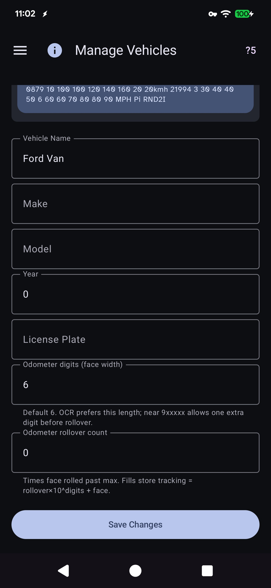

### Оријентири: поправи оно што је Дисцовери пропустио

Након **Прикажи оријентире**, померите листу и исправите вредности. Моторима понекад недостају мале цифре (на пример, сат **60** у доњем десном углу кластера). Користите **Измени ОЦР** да бисте их додали или поправили како би идентитет возила остао поуздан.

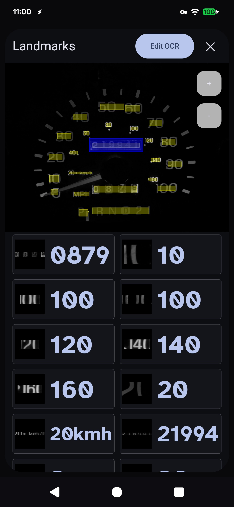

### Куцање без савршене фотографије

И даље можете да користите апликацију тако што ћете изабрати возило и **куцати** бројач километара, запремину и цену на Филл — ОЦР је опционалан за свако поље. Увоз галерије функционише за референтну слику на цртици када не желите да снимате у апликацији.

**Савет:** Након синхронизације табеле, дефиниције возила (усеви, оријентири) живе у локалној бази података — не морате поново да отварате Управљање возилима за попуну да бисте их користили.

---

## Резервне копије и синхронизација на више уређаја

Апликација је направљена тако да **неколико телефона или таблета може да дели исте податке о возном парку**, и тако да **копију својих података и фотографија можете задржати ван уређаја**. То се ради са одредиштима **која** конфигуришете под **вашим** налозима или **вашим** серверима који сами хостују – а не „облаком трошкова возила“ који други људи могу да виде.

### Шта где ради

| Кинд | Шта чува | Типична употреба |
|------|----------------|------------|
| **Табела/табеларна синхронизација** | Возила, точење горива, трошкови (редови и картице) | Спајање на више уређаја + структурирана резервна копија |
| **Резервна копија фотографија** | Бинарне слике (цртица/пумпа/признаница/референтне фотографије) | Резервна копија фотографија + враћање датотека које недостају |

Можете да конфигуришете **више одредишта** сваке врсте (софт цап по типу). Ручни радници **Синхронизуј одмах** и **позадински** радници покрећу оне који су омогућени.

###  Прво ван мреже

- **Није потребна мрежа** да бисте додали допуну, трошак или рачун. Све се чува **прво локално**.
– Када је мрежа доступна, синхронизација и резервна копија фотографија се покрећу као **задаци у позадини** (по распореду који сте поставили и када додирнете **Синхронизуј одмах**). Грешке се приказују као црвени текст испод редова Подешавања и **!** у насловној траци апликације.

### Само ваши налози

Пријава и токени остају на уређају за провајдере које одаберете (Гоогле, Мицрософт, С3 кључеви, УРЛ адресе које се сами хостују, итд.). Одредишта су под **потпуном контролом корисника** — ваш Гоогле налог, ваш ОнеДриве, ваша МинИО буцкет, ваш ЕтхерЦалц хост, итд. Ништа се не дели са другим корисницима Вехицле Екпенсес преко заједничког позадинског дела.

### Подржани циљеви — подаци (табела/табела)

Конфигурисано под **Мени → Синхронизација → Синхронизација табеле** (доступно и из редова резимеа подешавања). Опције првокласног бирача:

| Таргет | Нотес |
|-------|-------|
| **Гоогле табеле** | Цоммон дефаулт; картице за возила, трошкове и гориво по возилу |
| **Екцел** | Мицрософт радна свеска преко повезивања у стилу Грапх/ОнеДриве |
| **ЕтхерЦалц** | Собе за колаборативне табеле које се самостално одржавају |
| **Други →** имплементирани бацкендови | **Басеров**, **НоцоДБ**, **Аиртабле**, **ПоцкетБасе**, **Супабасе**, **Фиребасе**, **Зохо Схеет** |

Одложено / још није без главе (наведено под Остало, али није у потпуности примењено): ОнлиОффице, Цоллабора. Такође погледајте [индекс само-хостова] (reference/self-host/INDEX.md).

ЦСВ **извоз/увоз** (ЗИП истог изгледа картице) је доступан у подешавањима као преносива резервна копија, независно од синхронизације уживо.

### Подржани циљеви — фотографије (резервна копија слике)

Конфигурисано под **Мени → Синхронизација → Резервна копија фотографија** (такође из редова резимеа подешавања):

| Таргет | Нотес |
|-------|-------|
| **Гоогле диск** | Фолдер који изаберете (прегледајте или налепите УРЛ) |
| **ОнеДриве** | Мицрософт налог + префикс путање |
| **С3** | АВС, Васаби, Цлоудфларе Р2, МинИО и друге крајње тачке компатибилне са С3 |
| **Остало** | Складиште које подржава рцлоне (нпр. ВебДАВ, СФТП и други одабрани даљински управљачи доступни у бирачу у апликацији) |

Подесите цхеатсхеетс за фотографије и табеларне циљеве које сами хостују: [индекс само-хостова] (reference/self-host/INDEX.md).

### Понашање на више уређаја (кратко)

– Редови се спајају помоћу **ИД синхронизације** са **победама последњег писања** на **Ажурирано** временским ознакама.
- Брисања су мека; новија измена на другом уређају може да врати ред.
– Уношењем **исте попуне двапут** на два уређаја стварају се **два реда** — избришите вишак када приметите.
– Више детаља: [Белешке о понашању при синхронизацији](#sync-behavior-notes) и [СИНЦ_БЕХАВИОР.мд](reference/SYNC_BEHAVIOR.md).

### Пример: додајте Гоогле табеле (подаци)

1. **Мени → Синхронизација → Синхронизација табеле** (или Подешавања → Синхронизација табеле).

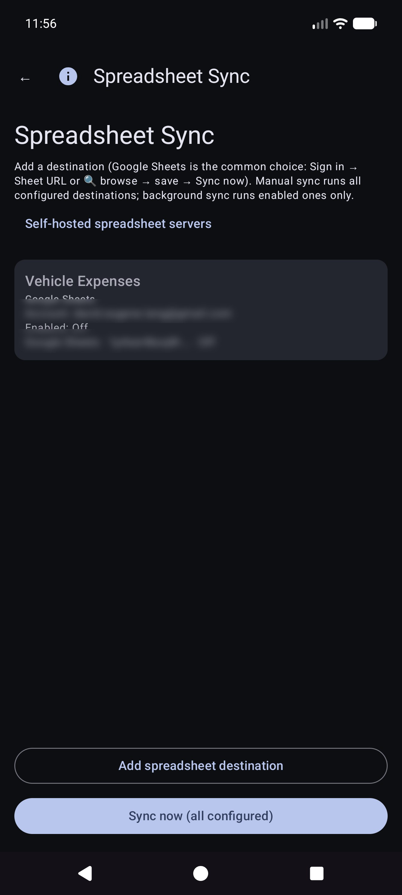

2. Додирните **Додај одредиште табеле**.

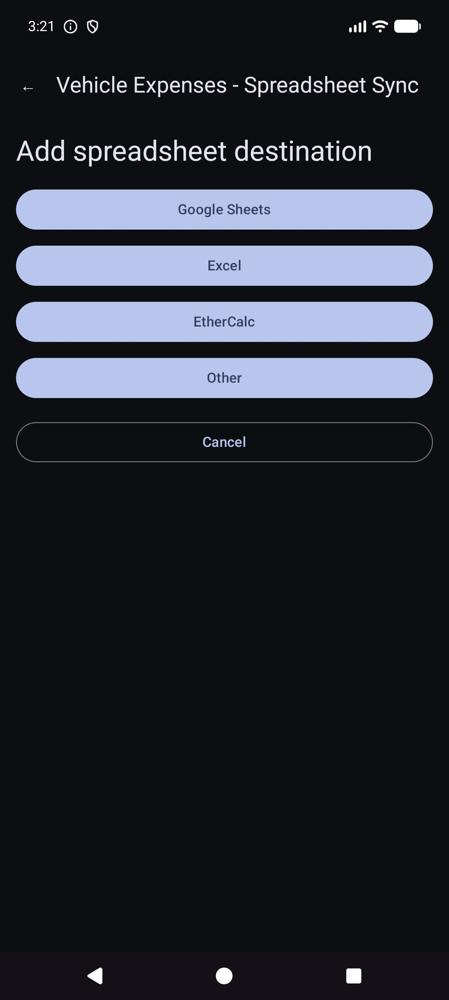

3. Изаберите **Гоогле табеле**.

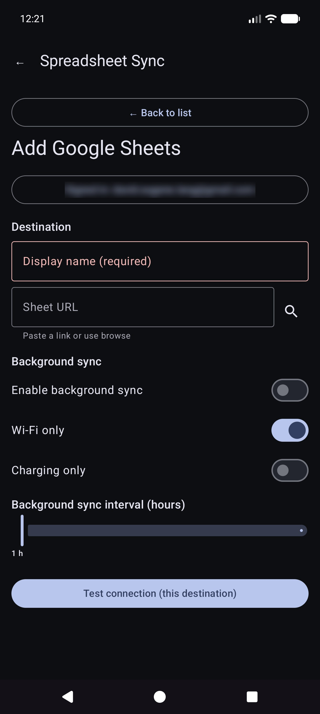

4. **Пријавите се на Гоогле** једном — то пријављивање вам такође омогућава да прегледате. Име за приказ → налепите **УРЛ листа** (још увек важи) или **🔍** прегледајте. Прегледај се отвара на **Све и дељено** да бисте могли да изаберете постојећу табелу коју поседујете или која се дели са вама. Затим опције распореда → омогући → сачувај.
5. **Синхронизујте одмах** једном да бисте креирали/ажурирали картице: `Vehicles`, `Expenses`, `Fuel - {vehicle name}`.

### Пример: додајте Гоогле диск (фотографије)

1. **Мени → Синхронизација → Резервна копија фотографија** (или Подешавања → Резервна копија фотографија).

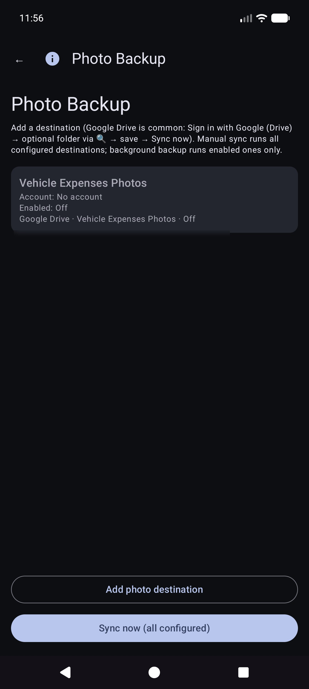

2. Додирните **Додај одредиште фотографије**.

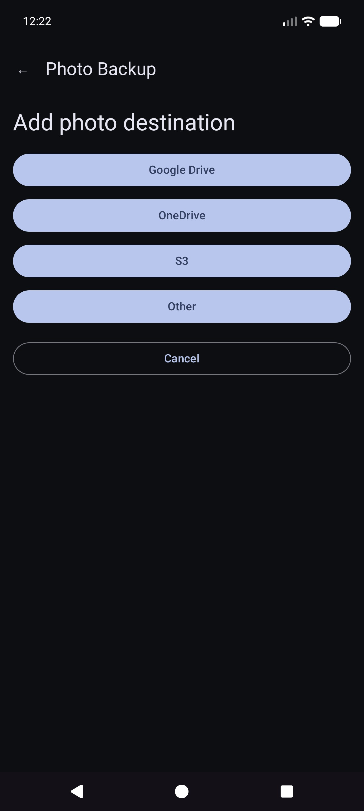

3. Изаберите **Гоогле диск**.

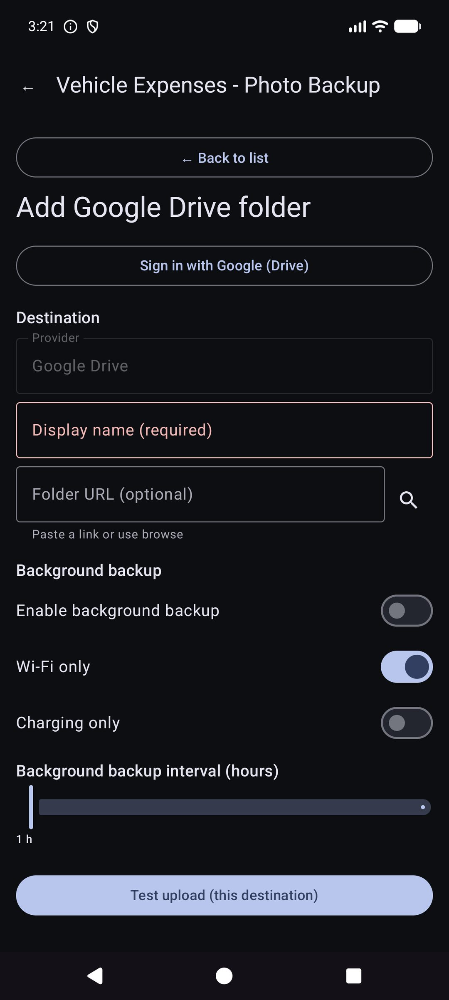

4. **Пријавите се помоћу Гоогле-а (Диск)** → опциони УРЛ фолдера/претражите → омогућите → сачувајте → **Синхронизујте одмах**.

Ручно **Синхронизуј одмах** за фотографије је пун погодак; позадинска резервна копија обично обрађује отпремања **само на чекању** по распореду.

### Синхронизујте белешке о понашању

– Након надоградње апликације можете накратко видети **“Ажурирање базе података након надоградње…”** (локално попуњавање ИД-а синхронизације).
- Ако је синхронизација прекинута, следећа **успешна** синхронизација се поново спаја и поправља удаљене картице.
– Грешке: црвени резиме на картицама за синхронизацију + **!** на траци апликација.

---

## Напуните (гориво)

Ово је **почетни екран** када отворите апликацију.

### Одабир возила (обично аутоматски)

Не морате **не** прво да изаберете возило. Када возила имају **оријентире** подешене у Управљај возилима, Филл **аутоматски открива које возило** са слике на контролној табли након што снимите бројач километара. И даље можете да отворите падајући мени **Возило** да бисте га заменили ако је потребно.

###  Циљајте на бројач километара

Останите у режиму бројача километара и уоквирите кластер. Упутство: *Циљајте на бројач километара. Додирните затварач да бисте снимили.*

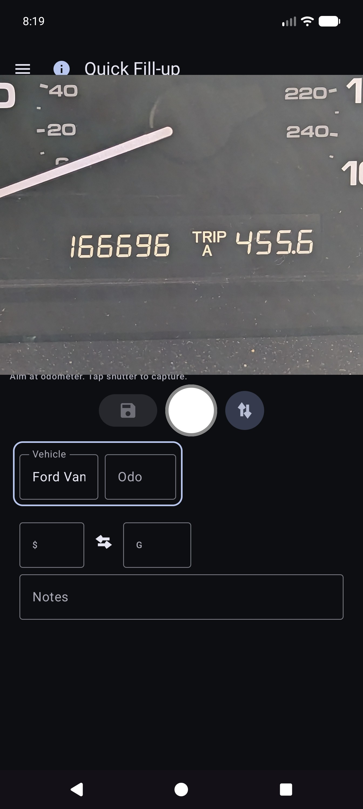

### После затварача километраже

ОЦР попуњава **Одо** и покушава да усклади возило са оријентира (прегледајте оба ако је потребно). Главно дугме постаје **Покушај поново** за поновно снимање. Упутство резимира читање.

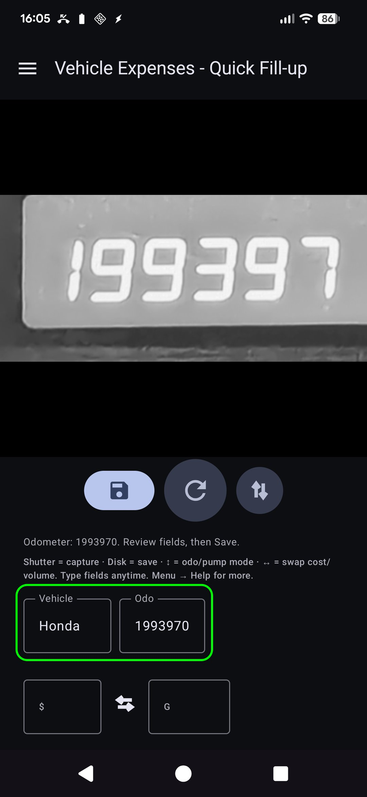

### Режим пумпе (цена и запремина)

1. Додирните **↕** да бисте прешли на режим пумпе: *Циљајте на приказ пумпе (цена/запремина). Додирните окидач.*
2. Ухватите укупне вредности пумпе. Попуните поља за трошкове и обим; користите **↔** ако су замењени.
3. Додирните валуту или **Г/Л** ако је потребно, а затим **Сачувај** (диск). Празна поља чине **делимично попуњавање** (и даље је дозвољено).

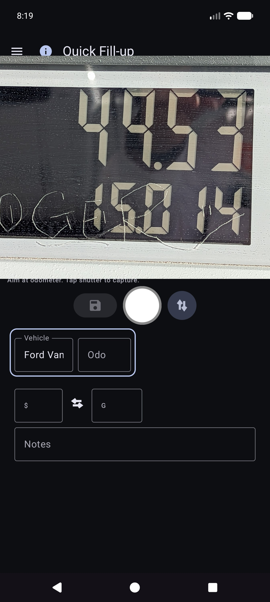

Остајете на Попуни за следећу станицу (поља се бришу након чувања). Радите потпуно **офлајн**; синхронизација се покреће касније у позадини када је конфигурисана.

### Ручни унос (без камере/лош ОЦР)

1. Додирните **Одо**, **цена** или **јачина** и унесите вредности (усправни користи системску тастатуру; пејзажни користи тастатуру на екрану).
2. Изаберите или потврдите **Возило** ако аутоматско откривање није покренуто.
3. Сачувајте као горе.

### Режими и границе

- **Зелена ивица** око возила+одо → снимање/уређивање бројача километара.
- **Зелена ивица** око цене+запремина → режим пумпе.
- **Сачувај** остаје онемогућено све док се не изабере возило и бар један од одо/цена/волумен има податке, а ОЦР још увек не ради.

Савет на екрану (испод инструкције): *Окидач = снимање · Диск = чување · ↕ = режим одо/пумпе · ↔ = цена замене/обим.*

---

##  Трошкови

### Нови трошак

Мени → **Нови трошак**.

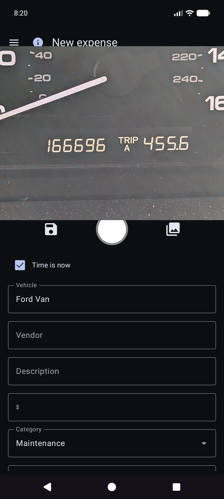

1. **Сачувај** (диск), **затварач** (фотографија рачуна) или **галерија** (изабери слику).
2. Попуните **Датум**, **Возило**, **Продавац**, **Опис**, **Износ** (симбол валуте се може додирнути), **Категорија**, опционо **Одометар**.
3. Потврде са више страница: снимање додатних страница ако кориснички интерфејс нуди пејџинг (страница 0 је примарна признаница).
4. **Сачувај** за складиштење (прво локално; резервна копија фотографија и синхронизација табеле се дешавају у позадини када су конфигурисани).

### Листа трошкова

Мени → **Извештаји** → **Листа трошкова** — прегледајте претходне трошкове који нису за гориво; отворите ставку за уређивање.

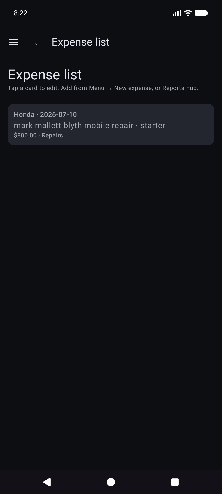

### Измени трошак

Отворите ред са листе. Тачан добављач, количина, категорија, возило и опис. Ако се признаница налази само у резервној копији фотографије (нема читљиве локалне датотеке), користите **Преузми слику из архиве** када се прикаже (ради на конфигурисаним одредиштима за фотографије).

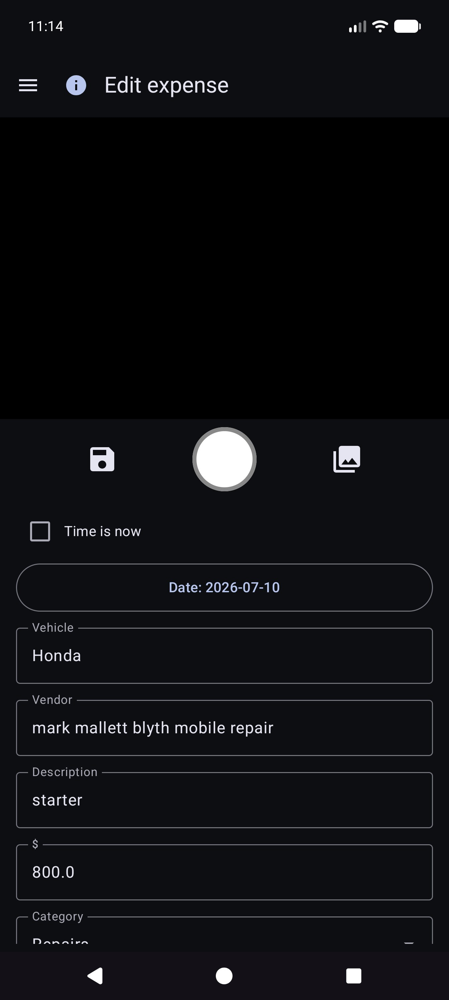

---

## Почните путовање

Мени → **Започни путовање** (након Попуни фиоку). Снимите или унесите километражу, изаберите тип путовања, сачувајте помоћу иконе **диск**. **Стоп** је пречица за Лично сада на задржаној ГПС локацији. Користите **ⓘ** за контролне подсетнике.

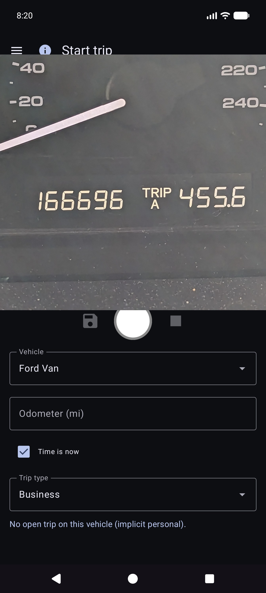

Почеци путовања се чувају као редови горива са **Тип путовања** (не нормално пуњење). Појављују се под **Извештаји → Путне миље**, а не под Историја горива.

---

## Извештаји

Мени → **Извештаји** отвара чвориште производа (свевремени резиме + каталошке картице). Ово је једина површина са извештајима о производу — не постоји посебна ставка фиоке „Извештаји и графикони“.

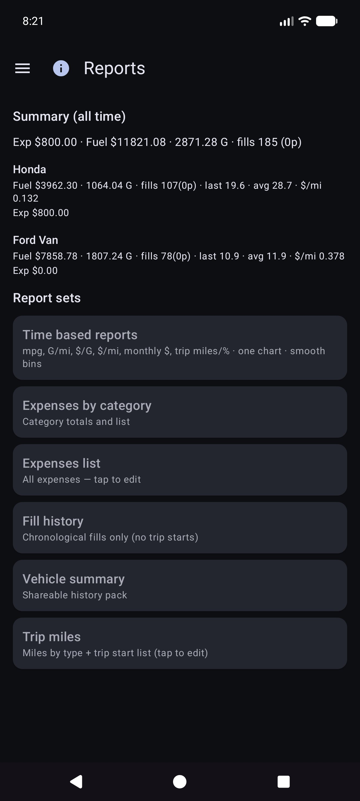

Отворите картицу за режим возила (**Све / Сваки / Појединачно**), филтере периода, графиконе и дељење (**ТЕКСТ / ЦСВ / ПДФ**). Горња трака на деци за пријаву: **☰ + ←** (и **ⓘ** када сте регистровани).

### Извештаји засновани на времену

Главна карта графикона. Опциони показатељи (миља по галону, запремина/раздаљина као што је Г/ми, цена јединице као што је $/Г, цена/раздаљина, месечни $, миље путовања, проценат пута по типу) са **Глатким** корпама и **независним И скалама** (економија лево; новац и породице путовања на десној страни).

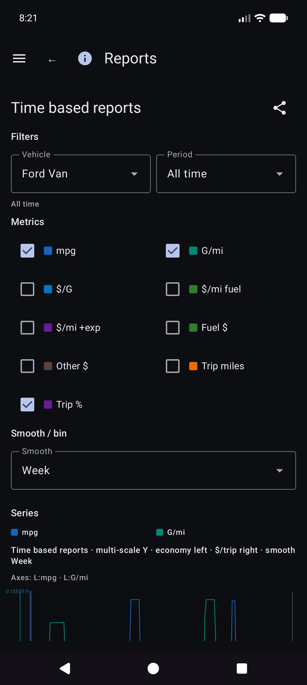

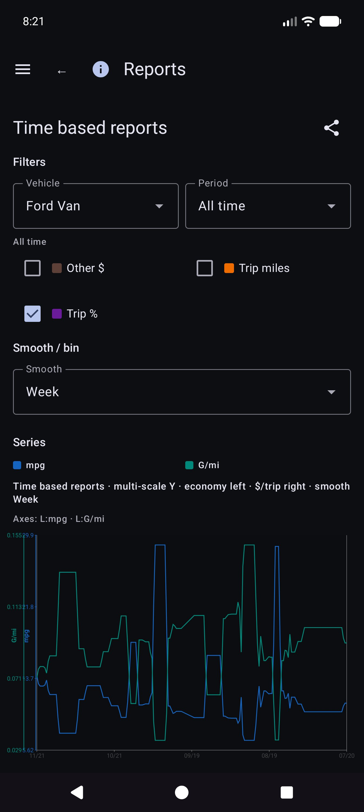

Детаљи економске математике: [РЕПОРТС_МЕТРИЦС.мд](reference/REPORTS_METRICS.md).

### Историја пуњења у односу на историју горива

- **Извештаји → Историја попуњавања** — хронолошко попуњавање филтера извештаја (**само попуњавање**; путовање не почиње).

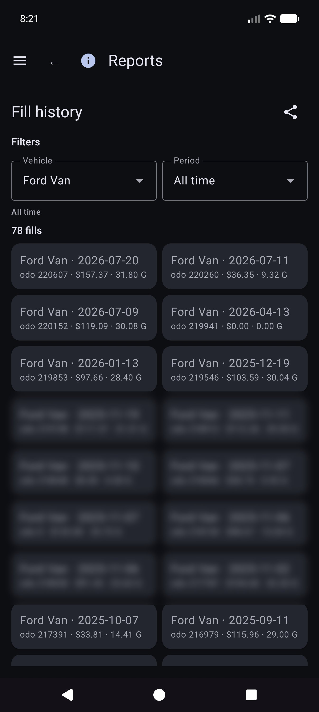

- **Историја горива** (ако је присутна у навигацији ваше верзије) — попуни инвентар по возилу, такође се попуњава само; додирните ред да бисте изменили.

###  Путне миље

**Извештаји → Путне миље** — миље по типу, графиконима и хронолошки **почетак путовања / листа сегмената**. Додирните прави почетак да бисте отворили **Измени попуну** за тај ред.

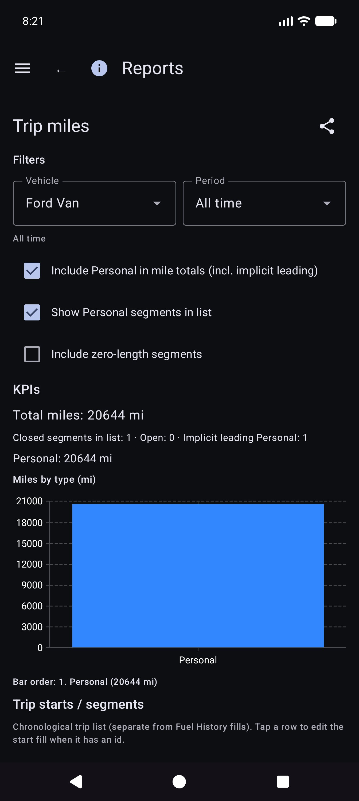

### Измени попуњавање

Из Историја пуњења, Историја горива или Путних миља отворите пуњење. Изглед: возило и бројач километара, **валута пре цене**, запремина, белешке. Тип путовања се појављује само када је ред почетак путовања. Локација има резиме плус **Детаљи локације**. Недостаје локална фотографија са идентитетом у облаку: **Преузми слику из архиве**.

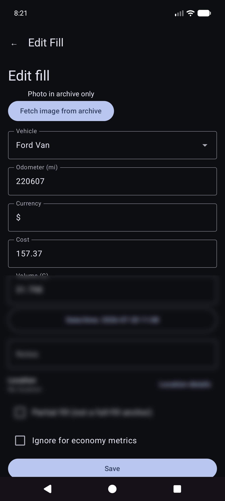

Остале каталошке картице укључују трошкове по категорији, резиме возила и листу трошкова.

Новац користи валуту сваког реда када је подешен. Збирне вредности у мешовитим валутама показују **подзбире по валути** (без тихе конверзије валута).

---

## Синхронизација

Мени → **Синхронизација** је чвориште за одредишта за табеле и фотографије (не само закопане у подешавањима).

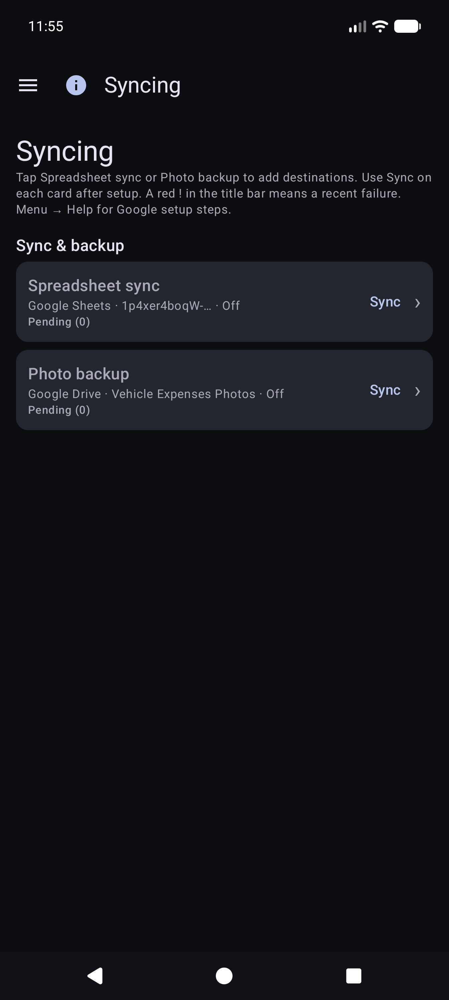

– Картице за **Синхронизацију табеле** и **Резервну копију фотографија** са кратким статусом, **Синхронизација** за ту врсту и **›** на листи одредишта.
- Отворите одредиште за **Тест везу** и **Синхронизујте сада (ова дестинација)** / све је конфигурисано.
- Грешка **Детаљи** и црвено **!** у насловној траци слете овде.
– Корак по корак подешавање Гоогле табела и диска: [Резервне копије и синхронизација на више уређаја] (#backups-and-multi-device-sync).

---

## Подешавања (локалне поставке)

Мени → **Подешавања**.

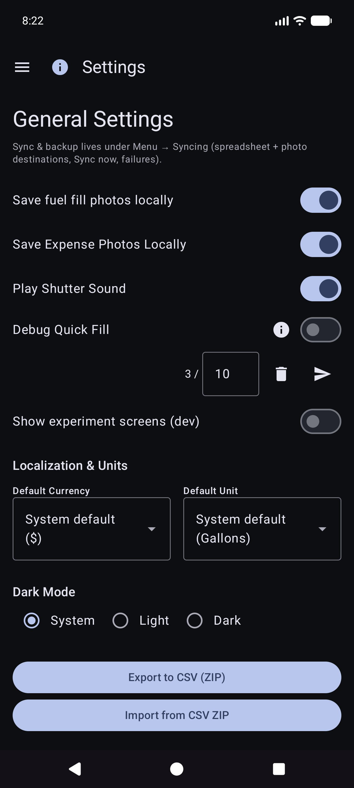

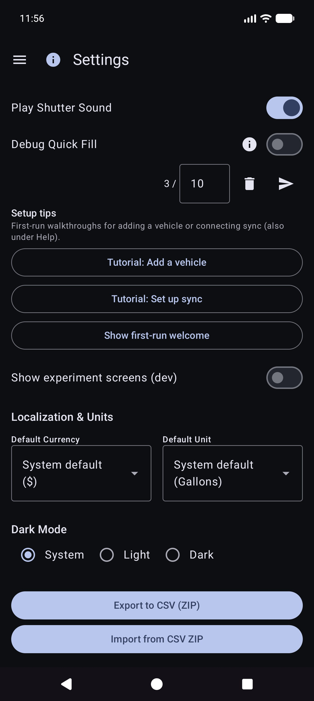

За одредишта, преферирајте **Мени → Синхронизација**. Подешавања могу и даље да приказују редове са резимеом који отварају исте листе.

### Локална подешавања (уобичајена)

- **Сачувајте фотографије рачуна за гориво** / **Локално сачувајте фотографије трошкова** — чувајте слике на уређају (може захтевати дозволу за фотографије).
- **Пусти звук затварача**
- **Валута** / **Јединица запремине** — подразумеване вредности апликације (системске или експлицитне). Промена јединице запремине са постојећим подацима о гориву може понудити дијалог за конверзију.
- **Тамни режим**
- **Савети за подешавање** — поново отворите упутства за прво покретање возила / синхронизацију.
- **Дебуг Филл** / **Прикажи екране експеримента (дев)** — напредно; оставити за свакодневну употребу. Екрани експеримента овде нису документовани.

ЦСВ **извоз/увоз** (ЗИП картица за возила / Трошкови / Гориво) је доступан у подешавањима када га нуди тренутна верзија.

---

## Хелп & Абоут

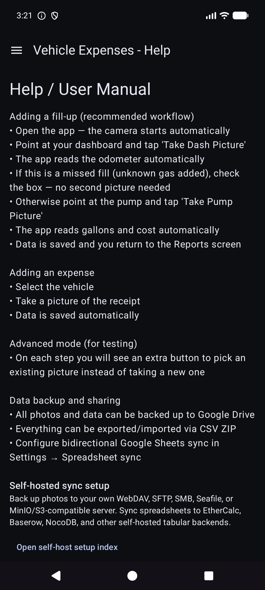

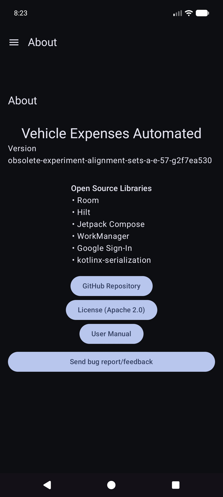

- **Помоћ** — брзи почетак на уређају, упутства за подешавање, линк до овог приручника, индекс подешавања самосталног домаћина.
- **О** — верзија, лиценце, ГитХуб, овај приручник (у пакету ван мреже + ХТМЛ на мрежи када је објављен).

---

## Сродни документи

- [КУИЦК_ГУИДЕ.мд](../QUICK_GUIDE.md) — кратак свакодневни водич
- [селф-хост/ИНДЕКС.мд](../reference/self-host/INDEX.md) — подешавање фотографија/табеле са сопственим хостом
- [СИНЦ_БЕХАВИОР.мд](../reference/SYNC_BEHAVIOR.md) — спајање, опоравак, дупликати
- [РЕПОРТС_МЕТРИЦС.мд](../reference/REPORTS_METRICS.md) — детаљ економских метрика
